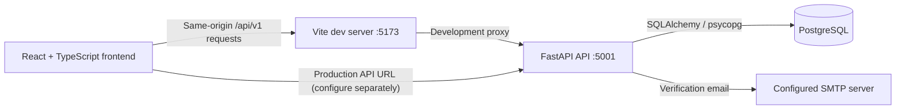

# AgriSense AI

**Practical farm records and transparent, data-grounded reporting.**

AgriSense AI is an early-stage farm-management application for farmers and agricultural teams who need a place to organize farm profiles and generate readable reports from the information they have recorded. Its current reports clearly identify missing measurements instead of presenting estimated weather, crop health, or yields as facts.

The project is under active development. The working application includes account registration and email verification, owner-scoped farm management, a dashboard, and rule-based reports. Several other screens are frontend prototypes whose corresponding backend services are not implemented yet.

> **Live demo:** No verified demo URL is published in this repository.
>
> **Screenshots:** Screenshots are not included yet. To add them, capture the running UI, add reviewed image files under a directory such as `docs/screenshots/`, and replace this note with Markdown image links. Do not use mock or placeholder images as product screenshots.

## Contents

- [Project status](#project-status)
- [Features](#features)
- [Screenshots](#screenshots)
- [Architecture](#architecture)
- [Technology stack](#technology-stack)
- [Repository layout](#repository-layout)
- [Local development setup](#local-development-setup)
- [Environment variables](#environment-variables)
- [API reference](#api-reference)
- [Database and migrations](#database-and-migrations)
- [Tests and quality checks](#tests-and-quality-checks)
- [Contributing](#contributing)
- [Roadmap](#roadmap)
- [License](#license)

## Project status

| Area | Status |
| --- | --- |
| Registration, login, signed access tokens, and email verification | Implemented |
| PostgreSQL persistence for users, farms, refresh tokens, verification challenges, and reports | Implemented; requires configured database and migrations |
| Farm create, list, view, update, and delete | Implemented |
| Dashboard farm totals and device-local legacy report activity | Implemented |
| Rule-based reports from saved farm profiles and persistent report history | Implemented |
| Email delivery | Implemented through a configured SMTP server |
| Logout endpoint, password-reset endpoints, disease-analysis backend, crop-recommendation backend, weather backend, AI chat backend | Not implemented in this backend |
| Production hosting, deployment manifests, and Docker setup | Not included in this repository |

The frontend contains screens and API clients for some unfinished features. A screen or declared client endpoint does not imply that a corresponding backend API is available. See [Planned and incomplete work](#planned-and-incomplete-work).

## Features

### Implemented

- **Authentication:** Account registration, email verification, password login, bearer access tokens, and rotating refresh tokens. Passwords are hashed with Argon2. Protected API routes require a verified account.
- **Email verification:** Verification links are sent through SMTP. Challenges are stored as hashes, expire, and have resend and attempt limits. Email delivery must be configured for registration to send a link.
- **Farm management:** Create, list, view, update, and delete a user's farms. Farm records are stored in PostgreSQL and are scoped to their owner.
- **Dashboard:** Displays farm count, recorded acreage, and locations. Its recent-report summary currently reads legacy report history from the current browser; the Reports page reads persistent server history.
- **Rule-based reports:** Generate and store crop-health, weather-summary, soil-analysis, and yield-forecast report records from farm profile fields. Reports do not call AI or weather services. They disclose missing source data and avoid inventing measurements or forecasts.
- **Report history and export:** List persisted reports for the signed-in user and export report summaries and their structured content as a text file. Older device-local report entries may still appear in the Reports page.
- **Frontend foundations:** Public home page, protected application routes, responsive shared layouts, form validation, and local display preferences.

### Planned and incomplete work

- Connect weather and forecast screens to a real weather service.
- Implement AI Chat backend functionality.
- Implement disease-image analysis and crop recommendation backend functionality.
- Add AI-powered report analysis only after suitable data sources, safety constraints, and service integrations are defined.
- Implement password reset and server-side logout/revocation endpoints.
- Add deployment configuration and operational documentation.

## Screenshots

No product screenshots are currently committed. Add real screenshots under `docs/screenshots/` (or another documented image directory), then replace this section's notice with Markdown image links using repository-relative paths.

Do not add generated or illustrative imagery in place of screenshots of the working application.

## Architecture



In local development, the Vite server proxies `/api/v1` to `http://127.0.0.1:5001`. The proxy exists only in the Vite development configuration. The backend owns authentication, farm CRUD, and report persistence; the browser attaches the access token to API requests. PostgreSQL is the application database, and SMTP is used for verification email delivery.

## Technology stack

| Concern | Technologies used |
| --- | --- |
| Frontend | React 19, TypeScript, Vite, React Router, Axios, Tailwind CSS, React Hook Form, Zod, Framer Motion |
| Backend | Python 3.10+, FastAPI, Pydantic, SQLAlchemy 2, Alembic, Uvicorn |
| Database | PostgreSQL with Psycopg 3; SQLite is used by isolated backend tests |
| Authentication | PyJWT signed tokens, `pwdlib` Argon2 password hashing, bearer authorization |
| Email | Python standard-library SMTP and email modules with STARTTLS support |
| Frontend quality checks | TypeScript, ESLint, Node's built-in test runner |
| Backend quality checks | pytest and HTTPX |

Versions declared by the project are in [package.json](package.json) and [backend/pyproject.toml](backend/pyproject.toml). The backend declares Python `>=3.10`. The frontend package does not declare a Node.js `engines` range; the `test:api` script uses Node's `--experimental-strip-types` option, so use a Node.js release that supports that option (Node 22.6 or newer).

## Repository layout

```text
.
├── backend/
│   ├── app/
│   │   ├── api/
│   │   │   ├── routes/       # Registered FastAPI route modules
│   │   │   └── schemas/      # Pydantic request and response schemas
│   │   ├── auth/             # Password, token, and verification logic
│   │   ├── core/             # Backend settings
│   │   ├── db/
│   │   │   └── models/       # SQLAlchemy models
│   │   └── services/         # Email delivery and report generation
│   ├── migrations/versions/  # Alembic schema revisions
│   ├── tests/                # Backend tests
│   ├── .env.example
│   ├── alembic.ini
│   └── pyproject.toml
├── public/                   # Static frontend assets
├── src/
│   ├── components/           # Shared UI, layout, and farm components
│   ├── pages/                # Public, auth, and dashboard screens
│   ├── routes/               # Application route tree and guards
│   ├── services/             # Frontend API clients
│   ├── styles/
│   └── types/
├── tests/                    # Frontend API utility tests
├── .env.example
├── package.json
└── vite.config.ts
```

## Local development setup

These instructions use a POSIX-style shell. PostgreSQL installation and service-management commands vary by operating system; install and start a supported local PostgreSQL server before continuing.

### Prerequisites

- Git.
- Node.js and npm. Use Node.js 22.6 or newer if you want to run the `test:api` script.
- Python 3.10 or newer and `venv`.
- PostgreSQL with a local database and a role allowed to connect to it.
- SMTP server credentials if you want to exercise registration and email verification end to end.

The repository does not pin a PostgreSQL major version. Use a maintained PostgreSQL release compatible with Psycopg 3.

### 1. Clone the repository

```bash
git clone https://github.com/DivyanshSingh9073/AgriSense-AI-.git
cd AgriSense-AI-
```

### 2. Create local environment files

Copy the templates, then edit the local files with your own development settings:

```bash
cp .env.example .env
cp backend/.env.example backend/.env
```

The root `.env` configures the Vite frontend. `backend/.env` configures the FastAPI backend and is loaded by the backend from its working directory. Both files are ignored by Git; never commit them or paste their contents into issues.

Set `DATABASE_URL` in `backend/.env` to the database you create below. Replace every placeholder in the backend template that is needed for your use case. In particular, do not leave SMTP placeholder values if you expect email delivery to work.

### 3. Create a PostgreSQL database

Ensure PostgreSQL is running and that your local PostgreSQL role can create databases. Then run:

```bash
createdb agrisense_ai
```

If your PostgreSQL setup requires a password or a different host, port, role, or database name, create the database using your normal PostgreSQL administration method and set the matching connection URL in `backend/.env`:

```text
postgresql+psycopg://<database-user>:<url-encoded-password>@localhost:5432/agrisense_ai
```

URL-encode any reserved characters in the password. Use a development database, and verify the host and database name before applying migrations. The application does not create database tables at startup.

### 4. Install and initialize the backend

In a new terminal from the repository root:

```bash
cd backend
python3 -m venv .venv
source .venv/bin/activate
python -m pip install --upgrade pip
python -m pip install -e ".[dev]"
alembic upgrade head
```

On Windows PowerShell, activate the environment with:

```powershell
.\.venv\Scripts\Activate.ps1
```

The migration command upgrades the configured database through the current Alembic head. It is not a reset command and does not drop existing tables. Review the target connection before running it.

### 5. Start the backend

Keep the backend terminal in the `backend/` directory with its virtual environment active:

```bash
uvicorn app.main:app --host 127.0.0.1 --port 5001 --reload
```

The backend API is at `http://127.0.0.1:5001/api/v1`. Interactive API documentation is available at `http://127.0.0.1:5001/docs`.

### 6. Install and start the frontend

In another terminal from the repository root:

```bash
npm install
npm run dev
```

Open `http://localhost:5173`. With the example frontend setting `VITE_API_BASE_URL=/api/v1`, the Vite development server proxies API requests to the backend on port `5001`.

### Email verification setup

Registration sends a verification link through SMTP. Configure the backend's `SMTP_HOST`, `SMTP_PORT`, and `SMTP_FROM_ADDRESS`; provide `SMTP_USERNAME` and `SMTP_PASSWORD` together when the relay requires authentication. The configured frontend base URL should be the origin where the Vite app is reachable. STARTTLS is on by default and is required in production when SMTP is configured.

The sample SMTP settings in `backend/.env.example` are placeholders, not a working relay. Registration returns a service error if email delivery is not configured or fails; the application does not silently report successful delivery. Verification links expire and resend/attempt limits apply.

### Generate a JWT secret

Create a fresh secret locally using Python:

```bash
python -c "import secrets; print(secrets.token_urlsafe(48))"
```

Copy the output into `JWT_SECRET_KEY` in `backend/.env`. Do not put the generated value in this README, source control, screenshots, logs, or issue reports. Production configuration requires a non-placeholder secret of at least 32 bytes with sufficient character diversity.

## Environment variables

The templates are [`.env.example`](.env.example) and [`backend/.env.example`](backend/.env.example). They contain placeholders only. Do not use the placeholders as live credentials.

### Frontend: root `.env`

| Variable | Example-template value | Purpose |
| --- | --- | --- |
| `VITE_API_BASE_URL` | `/api/v1` | API root used by the frontend. The Vite development proxy forwards this prefix to the local backend. Set an appropriate API root for a deployed frontend. |
| `VITE_APP_ENV` | `development` | Frontend environment label. The example comments list `development`, `staging`, and `production`; the frontend currently uses the value for configuration/display behavior and does not perform server-side validation. |

Variables with the `VITE_` prefix are included in browser-side frontend configuration. Do not place secrets in the root `.env`.

### Backend: `backend/.env`

| Variable | Example-template value | Purpose |
| --- | --- | --- |
| `APP_ENV` | `development` | Backend environment mode. In production, additional JWT and SMTP security checks apply. |
| `CORS_ORIGINS` | `http://localhost:5173` | Comma-separated, exact browser origins allowed by FastAPI. Wildcard origins are rejected. The default development origin is used when this value is omitted outside production; production has no default allowed origin. |
| `DATABASE_URL` | Placeholder PostgreSQL URL | SQLAlchemy connection string. Configure a real local PostgreSQL URL before running migrations or database-backed API operations. |
| `JWT_SECRET_KEY` | Placeholder | Signing secret for access and refresh tokens. Set a unique secret locally; production requires at least 32 bytes, sufficient character diversity, and a non-placeholder value. |
| `ACCESS_TOKEN_EXPIRE_MINUTES` | `15` | Access-token lifetime in minutes. |
| `REFRESH_TOKEN_EXPIRE_DAYS` | `7` | Refresh-token lifetime in days. |
| `FRONTEND_BASE_URL` | `http://localhost:5173` | Frontend origin used to construct email verification links. Production verification links require HTTPS. |
| `SMTP_HOST` | Placeholder host | SMTP server hostname. Required for verification email delivery. |
| `SMTP_PORT` | `587` | SMTP server port. Must be a valid positive TCP port. |
| `SMTP_USERNAME` | Placeholder | Optional SMTP login name. Configure it together with `SMTP_PASSWORD` when SMTP authentication is required. |
| `SMTP_PASSWORD` | Placeholder | Optional SMTP password. Configure it together with `SMTP_USERNAME`; never commit it. |
| `SMTP_FROM_ADDRESS` | Placeholder sender | Sender address/header used for verification mail. Required for delivery. |
| `SMTP_USE_STARTTLS` | `true` | Enables SMTP STARTTLS. Production requires STARTTLS when SMTP is configured. |
| `EMAIL_VERIFICATION_EXPIRE_MINUTES` | `30` | Verification-link lifetime. |
| `EMAIL_VERIFICATION_RESEND_COOLDOWN_SECONDS` | `60` | Minimum resend cooldown per email address. |
| `EMAIL_VERIFICATION_MAX_RESENDS_PER_HOUR` | `5` | Maximum verification messages allowed per address within the configured hourly window. |
| `EMAIL_VERIFICATION_MAX_ATTEMPTS` | `5` | Maximum invalid verification attempts per challenge. |

Values shown above are copied from the example templates or backend defaults. Store actual values only in ignored local environment files or a deployment secret manager. Restart the backend after changing its environment.

## API reference

All paths below are registered under the `/api/v1` prefix. For example, the full path for `GET /farms` is `/api/v1/farms`. Endpoints marked **Bearer** require `Authorization: Bearer <access-token>`. Unverified accounts cannot access protected routes.

Most authentication responses use an envelope:

```json
{
  "success": true,
  "message": "…",
  "data": {}
}
```

Farm and report endpoints return their resource-specific response bodies directly. Invalid request bodies are rejected with HTTP 422.

### Health

| Method and path | Auth | Behavior |
| --- | --- | --- |
| `GET /health` | No | Returns `{"status":"ok"}` when the API process responds. |
| `GET /health/ready` | No | Checks database connectivity; returns `{"status":"ready","database":"ok"}` or HTTP 503 when unavailable. |

### Authentication

| Method and path | Auth | Request and response |
| --- | --- | --- |
| `POST /auth/register` | No | Request: `{"name":"…","email":"…","password":"…"}`. Returns HTTP 202 with a generic delivery response in `data`, including `email`, `emailSent`, and optional `retryAfterSeconds`. Does not issue tokens. |
| `POST /auth/login` | No | Request: `{"email":"…","password":"…"}`. Returns an auth envelope with `data.user` and `data.tokens.accessToken` / `data.tokens.refreshToken` for verified accounts. |
| `GET /auth/me` | Bearer | Returns the current user's profile in `data`, including verification state, without password data. |
| `POST /auth/refresh` | No; refresh token in body | Request: `{"refreshToken":"…"}`. Returns a new token pair in the auth envelope. The previous refresh token is consumed. |
| `POST /auth/verify-email` | No | Request: `{"token":"…"}`. Returns `data: {"verified":true}` for a valid, unused challenge. |
| `POST /auth/resend-verification` | No | Request: `{"email":"…"}`. Returns HTTP 202 with the same generic delivery-status shape as registration. |

Password registration policy: at least eight characters, including an uppercase letter and a number; name must be at least two characters. Login is denied until the email is verified.

**Not registered:** logout, forgot-password, and reset-password routes are referenced by frontend code but are not implemented in the backend.

### Farms

All farm routes require a Bearer access token and return farm resources directly, not the authentication envelope.

| Method and path | Request | Response |
| --- | --- | --- |
| `POST /farms` | `{"farm_name":"North Field","location":"Sample Region","soil_type":"Loamy","farm_size":4.25,"water_source":"Canal"}` | HTTP 201 and the created farm resource. `farm_name` and `location` are required; optional fields may be omitted. |
| `GET /farms` | — | Array of farms owned by the authenticated user. |
| `GET /farms/{farm_id}` | — | One owned farm. Missing and other users' farms both return 404. |
| `PATCH /farms/{farm_id}` | Only fields to change, for example `{"farm_name":"East Field"}` | Updated farm resource. |
| `PUT /farms/{farm_id}` | Same partial-update body as PATCH | Compatibility alias used by the current frontend; not included in the generated OpenAPI schema. |
| `DELETE /farms/{farm_id}` | — | HTTP 204 on success. |

`farm_size` must be positive when supplied and supports at most two decimal places. The client cannot choose `user_id`; ownership comes from the authenticated user.

### Reports

Both report endpoints require a Bearer access token. Reports are persisted and scoped to the signed-in user.

#### List report history

```http
GET /api/v1/reports
Authorization: Bearer <access-token>
```

Response: `{"reports":[...]}`. Each report includes `id`, `user_id`, `farm_id`, `farm_name`, `report_type`, `title`, `summary`, `content`, `created_at`, and `updated_at`. `content` contains `farm_profiles`, `unavailable_data`, and `limitations`.

#### Generate a report

```http
POST /api/v1/reports/generate
Authorization: Bearer <access-token>
Content-Type: application/json

{
  "farm_id": 1,
  "report_type": "crop_health"
}
```

`farm_id` must be an owned farm ID or `null`. `null` means use all farms owned by the current user, and is also valid when the user has no farms. `report_type` must be one of `crop_health`, `weather_summary`, `soil_analysis`, or `yield_forecast`.

The endpoint returns HTTP 201 with `{"report":{...}}` and stores the report. The generated content only reflects recorded farm profile fields. It identifies unavailable crop-health observations, weather readings, soil-test measurements, or yield data as appropriate; it does not fabricate an assessment from absent measurements.

### Routes declared by the frontend but not registered by this backend

The frontend has API clients or screens for disease detection, crop recommendation, weather, AI chat, and some profile/auth operations. Their paths do **not** appear in the registered backend routers and will not work against this API yet. Do not treat entries in the frontend endpoint constants as available backend endpoints.

## Database and migrations

SQLAlchemy models are registered in [`backend/app/db/models/__init__.py`](backend/app/db/models/__init__.py) and imported by Alembic so metadata and migrations include them:

| Model/table | Relationship and purpose |
| --- | --- |
| `User` / `users` | Account identity, password hash, and email-verification state. |
| `Farm` / `farms` | Belongs to a user; stores farm name, location, and optional soil type, size, and water source. |
| `RefreshToken` / `refresh_tokens` | Belongs to a user; tracks refresh-token identifiers, expiry, and revocation. |
| `EmailVerificationChallenge` / `email_verification_challenges` | Stores verification challenge hashes and expiration/rate-limit state; may reference a user. |
| `Report` / `reports` | Belongs to a user and may reference a farm. Stores report type, title, summary, structured JSON content, and timestamps. Deleting a farm leaves its report and clears the optional farm reference; deleting a user cascades to owned reports. |

The migration chain is:

1. `20261010_0001` — users and farms.
2. `20261010_0002` — refresh tokens.
3. `20261101_0003` — email-verification challenges.
4. `20261112_0004` — persisted reports.

Configure `DATABASE_URL` before invoking Alembic. From the `backend/` directory with the virtual environment active:

```bash
alembic upgrade head
```

This applies any revisions missing from the configured database up to the current head. Alembic migrations should be reviewed and applied intentionally; the application does not auto-create production tables. To inspect the current database revision:

```bash
alembic current
```

To create a future revision for a schema change:

```bash
alembic revision --autogenerate -m "describe the schema change"
```

Review autogenerated migrations before applying them. Do not use database-reset, table-drop, or data-deletion commands as a substitute for an upgrade.

## Tests and quality checks

Run frontend commands from the repository root:

```bash
npm run test:api
npm run lint
npm run build
```

`npm run test:api` runs the Node built-in test suite in `tests/`. `npm run lint` runs ESLint. `npm run build` runs the TypeScript project build and Vite production build.

Run backend tests from the `backend/` directory after installing `.[dev]`:

```bash
python -m pytest
```

Backend tests use isolated SQLite databases and HTTPX ASGI requests; they do not require a configured PostgreSQL database or live SMTP server. Run them with an active backend virtual environment.

## Contributing

Contributions and beginner questions are welcome. Before starting substantial work, open an issue describing the problem or proposed change so the scope can be discussed.

1. Fork the repository and create a focused branch from `main`, for example `fix/report-history`.
2. Keep changes scoped, follow the existing TypeScript/React and Python/FastAPI patterns, and avoid committing environment files, credentials, generated build output, or unrelated formatting changes.
3. Add or update focused tests for behavior changes. For API work, maintain request validation and authenticated user ownership checks.
4. Run the relevant backend tests and frontend test, lint, and build commands.
5. Open a pull request against `main` with a clear summary, motivation, test results, and any migration or environment-variable changes. Include screenshots for user-visible UI changes when available.

There is no repository-specific contribution guide or code-formatting command beyond the checks listed above; follow existing file conventions and explain any intentional deviations in the pull request.

## Roadmap

### Completed

- Email verification and verified-account authentication.
- Persistent, owner-scoped farm management.
- Rule-based report creation from actual stored farm-profile data.
- Persistent report history and text export.

### Planned or incomplete

- AI-assisted report analysis using explicitly sourced data and transparent limitations.
- Weather provider integration.
- AI Chat service.
- Disease detection and crop recommendation backends.
- Password reset and server-side logout/revocation.
- Deployment configuration, monitoring, and operational guidance.

## License

No license file is present in the repository. Add and review a license before redistributing this project or accepting contributions under an assumed open-source license.
